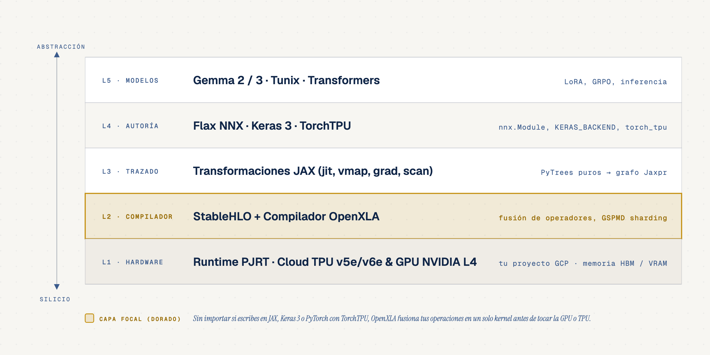
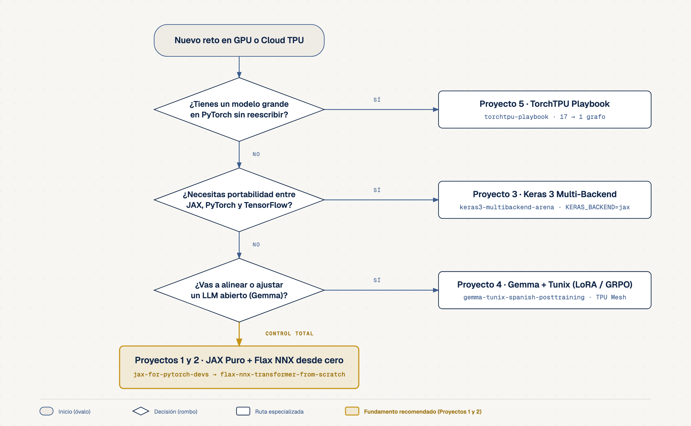
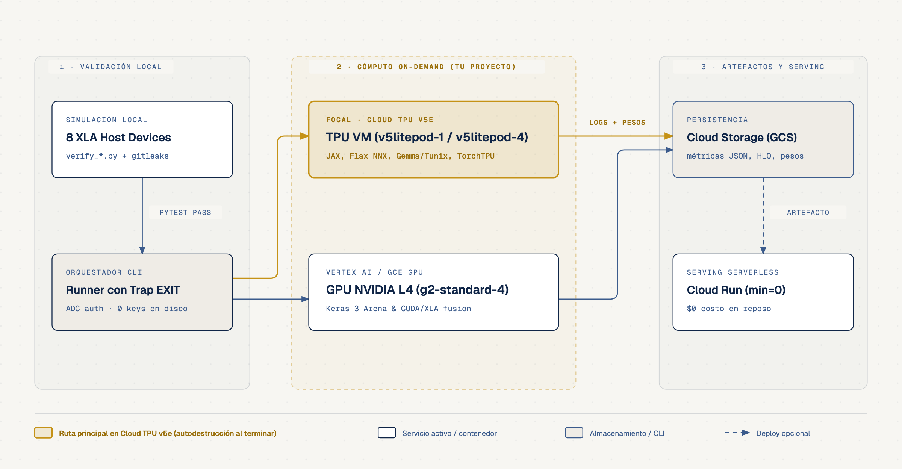

# Field Guide: De PyTorch a JAX y OpenXLA en Google Cloud

**Por qué es relevante:** El rendimiento real en GPUs modernas y Cloud TPUs depende del compilador (`OpenXLA` y `StableHLO`), no solo de la sintaxis en Python. Esta serie demuestra con código verificable cómo pasar de loops imperativos en PyTorch a grafos fusionados, particionamiento distribuido y post-entrenamiento de modelos abiertos.
**Para quién es:** Desarrolladores e ingenieros de Machine Learning que dominan PyTorch y buscan adoptar `JAX`, `Flax NNX`, `Keras 3`, post-training estilo `Gemma` con GRPO estilo `Tunix` o PyTorch en Cloud TPU con `TorchTPU` con garantías de rendimiento.
**Quién debería verlo:** Equipos de ingeniería de IA, arquitectos de inferencia/entrenamiento y líderes técnicos que operan cargas sobre GPUs (`NVIDIA L4` / `A100`) y `Cloud TPU v5e/v6e` en Google Cloud.
**Serie paralela para Software Devs (sin experiencia previa en PyTorch):** [JAX & ML for Software Devs Field Guide](https://github.com/ykro/jax-ml-for-software-devs-field-guide).

---

## Arquitectura General del Ecosistema

### 1. Jerarquía desde Python hasta el Silicio (`OpenXLA`)



### 2. Árbol de Decisión: ¿Por qué repositorio empezar?



### 3. Cómputo On-Demand en Google Cloud (en tu propio proyecto)



---

## Mapa de Repositorios y Resultados Verificados (Outside Judges)

Cada repositorio contiene **5 experimentos ejecutables (`01` a `05`)**, suite de tests con `pytest`, un script de verificación (`verify_*.py`, con checks deterministas; los tiempos varían entre corridas) y runners on-demand con auto-teardown para Google Cloud (`Vertex AI GPU L4`, `Cloud TPU v5e` y `Cloud Run` con escala a cero). Los runners están preparados, pero las cifras publicadas de la Serie A se midieron en el CPU de una laptop; cada speedup va con su baseline.

### Serie A — De PyTorch a JAX y OpenXLA

| # | Repositorio | Qué construye y demuestra | Outside Judge (Evidencia real medida) |
|---|---|---|---|
| **1** | [jax-for-pytorch-devs](https://github.com/ykro/jax-for-pytorch-devs) | Transición de loops imperativos de PyTorch a funciones puras, PyTrees, `@jax.jit`, `jax.vmap`, `jax.lax.scan` y *static bucket padding*. | **8.85x** con `@jax.jit` contra la misma función en JAX eager (5.64x contra PyTorch eager, sin `torch.compile`), **138.78x** en gradientes per-sample con `vmap` contra un loop de Python en JAX, **12.01x** con `lax.scan` contra un loop de Python de pasos compilados, y **24 → 3 compilaciones** con static bucket padding (53.76x sin contar el warmup de las cubetas). Paridad `max_diff <= 3.34e-06`. |
| **2** | [flax-nnx-transformer-from-scratch](https://github.com/ykro/flax-nnx-transformer-from-scratch) | Construcción de un Transformer causal con RoPE, RMSNorm y SwiGLU en `Flax NNX` (`nnx.Module`, `nnx.split`/`nnx.merge`, `@nnx.jit`). | Paridad `< 1e-6` con PyTorch, **1 traza y 0 recompilaciones** en 50 pasos con `@nnx.jit` (57 ops `dot_general`, cientos de fusiones en CPU), y el primer paso con compilación (`449.39 ms`) tarda **~136x** lo que un paso en caché (`3.3 ms`). Pérdida monótona `5.3140 -> 0.0105` sobre un batch fijo. |
| **3** | [keras3-multibackend-arena](https://github.com/ykro/keras3-multibackend-arena) | Red multimodal Vision+Tabular (`657,418` parámetros) escrita una sola vez con `keras.ops` y evaluada en `KERAS_BACKEND=jax`, `torch` y `numpy`, más un endpoint HTTP preparado para `Cloud Run`. | Paridad entre backends dentro del redondeo `float32` (`max_diff = 2.98e-07`). Keras-jax compilado en CPU contra Keras-torch eager en MPS (una Mac) da **~2x en entrenamiento** (`24,794.8` vs `12,401.3 samples/s`) y **1.82x en inferencia**; compilar, aislado en el mismo CPU, da **1.77x** en el forward. |
| **4** | [gemma-tunix-spanish-posttraining](https://github.com/ykro/gemma-tunix-spanish-posttraining) | Post-entrenamiento de un modelo estilo `Gemma 2` con pesos aleatorios (`4.2M` params base, sin checkpoint) sobre un mesh 2D (`data`, `model`) simulado con 4 dispositivos en CPU, LoRA quirúrgico y **GRPO** escrito a mano al estilo `Tunix`. | **97.90% reducción** de parámetros entrenables con LoRA (`0.0` drift en pesos base), **2.0x** menos pesos por dispositivo en el mesh `2x2` (aritmética del `PartitionSpec`), y recompensa greedy de **`-0.0625` a `+1.4875`** con **75%** de formato XML, tras 4 pasos de SFT de calentamiento y 24 de GRPO, evaluada sobre los mismos 4 prompts de entrenamiento. |
| **5** | [torchtpu-playbook](https://github.com/ykro/torchtpu-playbook) | PyTorch en `Cloud TPU` con `TorchTPU` (el reemplazo de PyTorch/XLA, deprecado y archivado el 15-nov-2026): eager contra `torch.compile(backend="tpu")`, diagnóstico de *graph breaks*, las 3 trampas de recompilación, sharding con `DeviceMesh` + DTensor y puente zero-copy `PyTorch <-> JAX` vía DLPack sobre StableHLO. Medido en CPU (TorchTPU solo existe para Linux x86_64). | Paso ingenuo con **3 grafos y 2 graph breaks** por llamada; corregido de **17 a 1** grafo en 6 batches con **0** recompilaciones tras warmup (`max_abs_diff = 1.8e-07`); DTensor en mesh `2x2` con **1 `all_reduce`** (paridad `6.6e-07`); `autograd.Function` llamando a `@jax.jit` con `grad_diff = 2.91e-11` y StableHLO de 28 ops. |

---

## Onboarding y Cómo Recorrer la Serie

Sigue los 5 niveles en orden progresivo desde tu terminal (o empieza por la [Serie B para Software Devs](https://github.com/ykro/jax-ml-for-software-devs-field-guide) si vienes de Python/NumPy sin PyTorch).

### 1. Orden progresivo de ejecución

1. **Nivel 1 — Fundamentos del compilador ([jax-for-pytorch-devs](https://github.com/ykro/jax-for-pytorch-devs))** para dominar `@jax.jit`, `Jaxpr`, `StableHLO`, PyTrees puros, `jax.vmap`, `jax.lax.scan` y *static bucket padding*.
2. **Nivel 2 — Ergonomía con estado en Python ([flax-nnx-transformer-from-scratch](https://github.com/ykro/flax-nnx-transformer-from-scratch))** para construir un Transformer causal con `nnx.Module`, `nnx.split` y `nnx.merge`.
3. **Nivel 3 — Portabilidad multi-backend ([keras3-multibackend-arena](https://github.com/ykro/keras3-multibackend-arena))** para comparar `KERAS_BACKEND=jax` contra `torch`, aislar lo que aporta compilar y preparar un endpoint para Cloud Run con escala a cero.
4. **Nivel 4 — Post-entrenamiento distribuido ([gemma-tunix-spanish-posttraining](https://github.com/ykro/gemma-tunix-spanish-posttraining))** para particionar modelos en meshes 2D `('data', 'model')`, inyectar adaptadores `nnx.LoRA` y alinear con GRPO.
5. **Nivel 5 — PyTorch en Cloud TPU ([torchtpu-playbook](https://github.com/ykro/torchtpu-playbook))** para llevar código `torch.nn.Module` a Cloud TPU con `TorchTPU`, compilar sin graph breaks ni recompilaciones, repartir con DTensor y llamar a `@jax.jit` desde PyTorch con DLPack.

### 2. Validar el índice maestro localmente

```bash
git clone https://github.com/ykro/jax-openxla-field-guide.git
cd jax-openxla-field-guide
python3 scripts/verify_series.py
```

El reporte consolidado se almacena automáticamente en `benchmarks/series_summary.json`.
